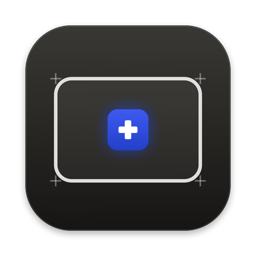

<h1 align="center">Pad+</h1>

Новые жесты для трекпада Mac. Края — ползунки, углы — кнопки, ладонь — история буфера.

<a href="https://github.com/ehroz1/padplus-releases/releases/latest"><b>⬇︎ Скачать последнюю версию</b></a> · <a href="https://ehroz.pro">ehroz.pro</a>

## Установка

1. Скачайте `Pad+-<версия>.dmg` из [последнего релиза](https://github.com/ehroz1/padplus-releases/releases/latest) и перетащите **Pad+** в «Программы».
2. Первый запуск: правый щелчок по Pad+.app → «Открыть» → «Открыть».
   Если macOS всё равно не пускает: «Системные настройки → Конфиденциальность и безопасность → Всё равно открыть»
   или в Терминале `xattr -dr com.apple.quarantine /Applications/Pad+.app`.
3. Pad+ проведёт короткую презентацию и попросит **Универсальный доступ** — без него жесты не смогут нажимать клавиши и двигать окна.

Работает на macOS 13 и новее, Apple Silicon и Intel.

## Что умеет

- **Края трекпада** — громкость, яркость или прокрутка страницы одним пальцем, с тактильным щелчком на каждом шаге.
- **Касания** тремя, четырьмя и пятью пальцами, двойной тап, тип-тап.
- **Углы** — касание или клик в углу: скопировать, вставить, рабочий стол, снимок экрана…
- **Окна** — свайп по заголовку ставит окно на половину экрана, щипок закрывает.
- **История буфера** — текст, картинки, файлы.
- На любой жест — своё сочетание клавиш или программа. Чувствительность, исключения, тема и цвет — в настройках.

## Обновления

Pad+ обновляется сам: раз в четыре часа он проверяет этот репозиторий, скачивает новую версию, сверяет SHA-256 и подпись и ставит её с перезапуском. Вручную — меню значка → «Проверить обновления…».

Настройки хранятся в `~/Library/Application Support/Ehroz/Pad+/settings.json` и переживают удаление приложения.

---

Здесь только готовые сборки. Сделано в мастерской <a href="https://ehroz.pro"><b>ehroz.pro</b></a>.
